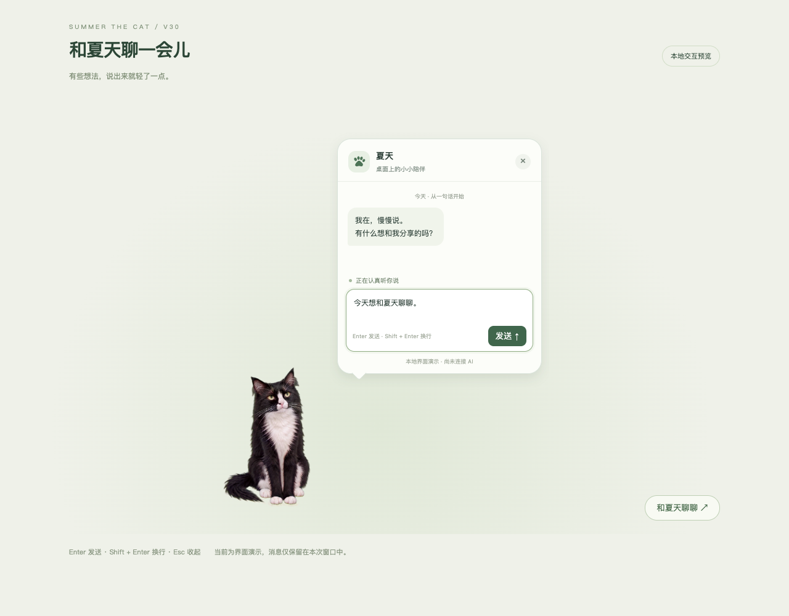

# Summer The Cat · v30

**可以聊天的桌面猫咪。** 基于真实猫咪形象和 AI 生成动画，结合 macOS 原生桌面交互、动作状态机与 Google Gemini / OpenAI 流式对话。

本次上传用户选定的 **v30** 源码。当前构建脚本版本为 **2.0.30.12**，与本地已确认的光标回退节点一致；不包含已撤销的后续光标范围与状态保存改动，也不包含系统级光标替换工具。



*上图为本地 UI 预览截图；实际模型连接由原生应用处理。*

## 功能

- **AI 对话**：支持 Gemini / OpenAI；流式显示、多轮上下文、停止、失败重试、新对话和服务商切换。
- **对话动作队列**：当前动作先完整播放，再进入歪头；等待期间循环，结束或关闭后在动画边界回正。
- **桌面陪伴**：静坐、动耳朵、张望、舔毛、打哈欠、八方向逗猫互动与随机行为。
- **专心模式**：根据屏幕可用空间避让，动作与窗口位移同步。
- **桌面控制**：悬浮菜单、托盘／菜单栏入口、拖动、置顶、鼠标穿透、显示大小、暂停与位置恢复。
- **动态逗猫棒**：羽毛和铃铛分层模拟惯性与阻尼，在应用互动范围内显示。

## AI 协作与技术

- 素材：先使用 Runway，后参考已有提示词迁移到即梦完成后续生成。
- 开发：使用 Codex 辅助完成需求细化、程序实现、调试和验证；作者负责动作要求、交互规则、素材筛选与验收。
- 桌面：Swift、AppKit、WebKit、JavaScript / WebGL2、Python 素材处理工具。
- 模型：原生 HTTPS 流式接口；服务商和模型按用户自己的账号与项目权限配置。
- 凭据：API Key 保存在本机 macOS 钥匙串，不写入网页、源码、发布包或 Git 仓库。

## 构建与运行

要求 **macOS 13+**，安装 Xcode Command Line Tools 后执行：

```sh
git clone https://github.com/Supreminian/SummerTheCat.git
cd SummerTheCat
zsh source/build.sh
open 'Summer The Cat AI.app'
```

构建 Apple Silicon / Intel 通用程序，使用本地 ad-hoc 签名；尚未进行 Apple 公证。构建使用仓库内现成图集，无需重新生成视频。

打开猫咪对话框的齿轮或菜单中的“AI 连接设置”，选择服务商并填入自己的 API Key。保存后可点击“验证对话”检查实际生成权限，此操作会使用该账号的 API 配额。独立打开 `source/chat.html` 只用于 UI 预览，不会直接读取原生凭据。

## 项目结构

```text
source/
  SummerTheCat.swift       macOS 桌面外壳
  ConversationUI.swift    对话窗口与请求生命周期
  OpenAIClient.swift      OpenAI 流式请求与上下文
  GeminiClient.swift      Gemini 流式请求
  OpenAISettingsUI.swift  原生模型连接设置
  playback.js             播放状态机
  chat-motion.js          对话动作排队
  mouse-interaction.js    鼠标互动
  build.sh                通用应用构建
pet-pack/                 动画配置、图集与封面
docs/                     接入说明、现有验证记录、截图与源码清单
```

仓库不包含预编译应用、安装包、历史版本、全局光标工具、缓存、API Key 或本地聊天记录。原始素材和运行图集较大，首次克隆需等待下载。部分素材处理辅助脚本保留了原开发环境依赖，应用构建不依赖重新处理素材。

## 检查

安装 Node.js 后，在仓库根目录执行：

```sh
node source/check_playback.mjs
node source/check_random_behavior.mjs
node source/check_mouse_interaction.mjs
node source/check_chat_queue.cjs
```

它们检查动作完整播放、随机动作边界、鼠标互动与聊天进入／退出队列。本次整理修正了旧随机行为检查对专心模式／聊天动作的分类，未改变运行时功能。

原生客户端的现有验证结果见 `docs/Gemini客户端验证.json` 和 `docs/OpenAI客户端验证.json`；这些使用模拟响应，不代表任意真实账号均已具备线上生成权限。实际连接需使用自己的密钥验证。

## 接入说明与边界

- [Google Gemini 接入](docs/Gemini接入说明.md)
- [OpenAI 接入](docs/OpenAI接入说明.md)
- [当前光标回退节点](docs/光标版本回退记录.json)
- 当前发布 **macOS v30**；未将旧 Windows 版本标为 v30。
- 当前为文字对话，没有加入语音、联网搜索、文件访问或控制电脑的 Agent 工具。
- 聊天记录仅保存在当前应用进程中；模型请求会发送问题及选取的上下文，数据处理以对应服务商政策为准。
